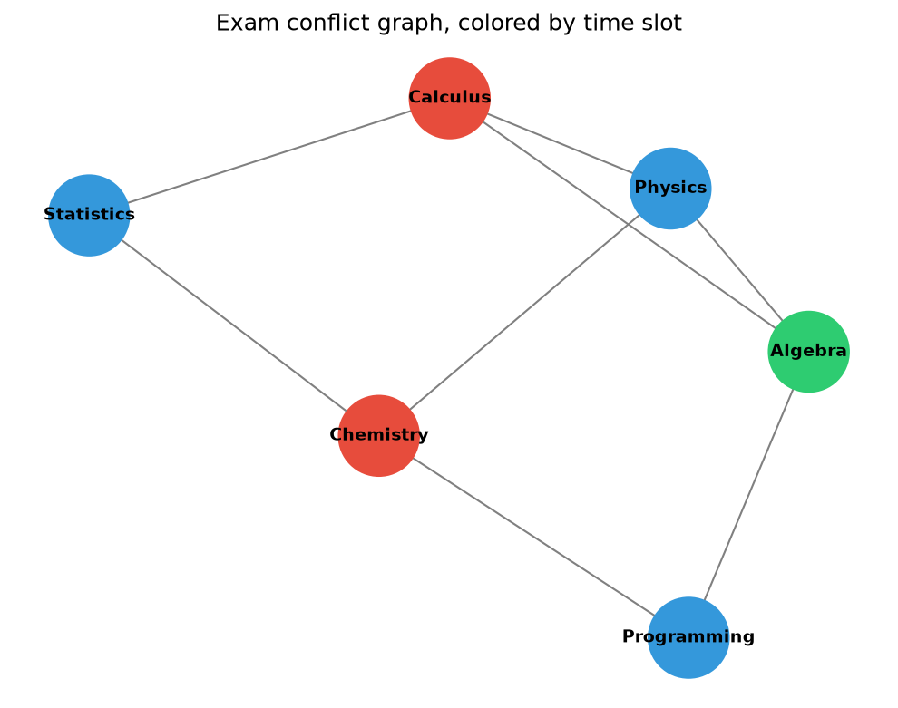

<!-- _class: lead -->
<!-- _paginate: false -->
<!-- _header: "" -->
<!-- _footer: "" -->

# Graph Coloring
## Concepts, Algorithms, and Real-World Implementation

Your Name · Student ID
Course Name · Lecturer · Date

<!--
Greet the audience. Open with: "How can we assign colors to things so that conflicting things never share the same color?"
-->

---

## Agenda

1. What is Graph Coloring?
2. Key concepts and theorems
3. Algorithms
4. Step-by-step example
5. Applications / implementations (**main focus**)
6. Code and **live demo**
7. Conclusion

<!--
Most of the time goes to real implementations, followed by a live demo.
-->

---

## Motivation: A Real Problem

> A university has 6 exams. Some students take several exams. Two exams with a shared student **cannot be at the same time**.
> What is the **minimum number of time slots** needed?

| Real world | Graph |
|---|---|
| Exam | Vertex |
| Shared student | Edge |
| Time slot | **Color** |

<!--
A scheduling problem is secretly a graph problem. Tip: show a table of exams on the left and the same data drawn as a graph on the right.
-->

---

## What is Graph Coloring?

- **Graph** G = (V, E): vertices V, edges E
- **Graph coloring:** give each vertex a color so that **no two adjacent vertices share a color**
- A coloring with *k* colors is a **k-coloring**
- **Goal:** use as few colors as possible

<span class="green">✔ Valid:</span> neighbors always differ
<span class="red">✘ Invalid:</span> two adjacent vertices have the same color

<!--
Stress the single rule: neighbors must differ. "Colors" can be anything: integers, time slots, frequencies, registers.
Optional: insert two small graph images here (valid vs invalid).
-->

---

## Key Terminology

| Term | Meaning |
|---|---|
| **Proper coloring** | No adjacent vertices share a color |
| **Chromatic number χ(G)** | Minimum number of colors needed |
| **Clique** | Vertices that are all mutually adjacent |
| **Max degree Δ(G)** | Largest number of neighbors of any vertex |
| **Independent set** | Vertices with no edges between them |

Each color class is an **independent set**.

<!--
Graph coloring = partitioning the vertices into the fewest independent sets.
-->

---

<!-- _class: small -->

## Properties & Theorems

- **Lower bound:** χ(G) ≥ ω(G) (size of the largest clique)
- **Upper bound:** χ(G) ≤ Δ(G) + 1 (greedy guarantee)
- **Brooks' theorem:** χ(G) ≤ Δ(G), unless G is a complete graph or an odd cycle
- **Special graphs:**
  - Complete graph Kₙ → χ = n
  - Bipartite graph / tree → χ ≤ 2
  - Even cycle → 2, odd cycle → 3
- **Four Color Theorem:** every planar graph (e.g., a map) is 4-colorable (Appel & Haken, 1976)

<!--
Don't prove anything. Present these as tools for estimating how many colors are needed.
-->

---

## Computational Complexity

- Is G **2-colorable**? Easy: O(V + E) with BFS/DFS
- Is G **k-colorable** for k ≥ 3? **NP-complete**
- Finding the exact χ(G) is **NP-hard**

**So in practice:**
- **Heuristics:** fast, good, not always optimal
- **Exact algorithms:** only for small graphs

<!--
This explains why we study several algorithms instead of one perfect one.
-->

---

<!-- _class: small -->

## Algorithms Overview

| Algorithm | Type | Idea | Complexity |
|---|---|---|---|
| **Greedy** | Heuristic | Color in given order, pick smallest free color | O(V + E) |
| **Welsh–Powell** | Heuristic | Greedy, sorted by **degree (descending)** | O(V²) |
| **DSATUR** | Heuristic | Next vertex = **most distinct neighbor colors** | O(V²) |
| **Backtracking** | Exact | Try colors, undo on conflict | Exponential |

<!--
Greedy depends on vertex order. Welsh-Powell and DSATUR improve the order. Backtracking is exact for a given k but slow.
-->

---

## Welsh–Powell Algorithm

```text
1. Sort vertices by degree, highest first
2. color = 1
3. While uncolored vertices remain:
     a. Give `color` to the first uncolored vertex
     b. Walk down the list: give `color` to every uncolored
        vertex NOT adjacent to a vertex already given `color`
     c. color = color + 1
```

**Intuition:** high-degree vertices are the most constrained, so color them first.

---

<!-- _class: small -->

## Worked Example: Welsh–Powell

**Edges:** `A-B, A-C, A-D, B-C, B-E, C-F, D-E, E-F`

<div class="cols">
<div>

| Vertex | A | B | C | D | E | F |
|---|---|---|---|---|---|---|
| Degree | 3 | 3 | 3 | 2 | 3 | 2 |

Sorted order: **A, B, C, E, D, F**

**Result:** 3 colors → χ(G) = 3
A-B-C is a triangle, so 3 is also the lower bound: **optimal**.

</div>
<div>

| Step | Action | Class |
|---|---|---|
| <span class="red">Color 1</span> | A ✓, B ✗, C ✗, E ✓, D ✗, F ✗ | {A, E} |
| <span class="blue">Color 2</span> | B ✓, C ✗, D ✓, F ✓ | {B, D, F} |
| <span class="green">Color 3</span> | C ✓ | {C} |

</div>
</div>

<!--
Walk through the table slowly. The triangle A-B-C proves we can't do better than 3.
Tip: draw the graph in draw.io or PowerPoint and animate Red -> Blue -> Green, or insert an image: 
-->

---

## Application 1: Scheduling

**Exam / class timetabling**

- Vertex = exam or course
- Edge = shared students, lecturer, or room
- Color = **time slot**
- Minimum colors = **minimum number of time slots**

Also used for meeting schedules, shift planning, and sports fixtures.

<!--
Link back to the motivating example. Used by universities worldwide.
-->

---

<!-- _class: small -->

## Application 2: Other Real-World Uses

| Domain | Vertices | Edge means | Color = |
|---|---|---|---|
| **Map coloring** | Countries / provinces | Share a border | Map color |
| **Register allocation** (compilers) | Variables | Alive at the same time | CPU register |
| **Channel assignment** | Wi-Fi routers / towers | Interference range | Frequency channel |
| **Sudoku** | 81 cells | Same row/column/box | Digit 1–9 |
| **Traffic lights** | Road movements | Would collide | Signal phase |
| **Chemical storage** | Chemicals | Dangerous together | Storage room |

<!--
Pick 2-3 to explain in more detail. Compilers and Wi-Fi channels are great for informatics students.
-->

---

<!-- _class: small -->

## Implementation (Python)

```python
def welsh_powell(graph):
    order = sorted(graph, key=lambda v: len(graph[v]), reverse=True)
    colors, c = {}, 0
    while len(colors) < len(graph):
        c += 1
        for v in order:
            if v not in colors and all(colors.get(u) != c for u in graph[v]):
                colors[v] = c
    return colors
```

- Graph = **adjacency list** (`dict` of sets)
- Code mirrors the pseudocode of Welsh–Powell
- Full code: `graph_coloring_demo.py`

---

<!-- _class: lead -->

## Live Demo
# Exam Scheduling with Graph Coloring

Input: exams + conflicts
Output: time slot per exam + graph picture

<!--
Switch to terminal/notebook.
1. Show the data (30 s)
2. Run the script: Greedy, Welsh-Powell, DSATUR (1 min)
3. Show exact answer by backtracking (30 s)
4. Show the schedule (30 s)
5. Show coloring.png (30 s)
Backup: have a screenshot or screen recording ready.
-->

---

## Demo Code (excerpt)

```python
exams = {
    "Calculus":    ["Physics", "Algebra", "Statistics"],
    "Physics":     ["Calculus", "Algebra", "Chemistry"],
    "Algebra":     ["Calculus", "Physics", "Programming"],
    "Statistics":  ["Calculus", "Chemistry"],
    "Chemistry":   ["Physics", "Statistics", "Programming"],
    "Programming": ["Algebra", "Chemistry"],
}
graph = {v: set(ns) for v, ns in exams.items()}

result = dsatur(graph)          # or welsh_powell(graph)
k = chromatic_number(graph)     # exact, via backtracking
```

<!--
Full script is in Appendix A of the presentation material file.
-->

---

## Conclusion

- Graph coloring turns **conflict problems** into a clean graph model
- Optimal coloring is **NP-hard**, but **Welsh–Powell** and **DSATUR** work well in practice
- Applications: **scheduling, compilers, wireless networks, maps, Sudoku**

> **Key takeaway:** *If things conflict, think graph coloring.*

---

<!-- _class: lead -->

# Thank You
## Questions?

---

<!-- _class: small -->

## References

- West, D. B. (2001). *Introduction to Graph Theory* (2nd ed.). Prentice Hall.
- Rosen, K. H. *Discrete Mathematics and Its Applications*. McGraw-Hill.
- Welsh, D. J. A., & Powell, M. B. (1967). An upper bound for the chromatic number of a graph and its application to timetabling problems. *The Computer Journal*, 10(1).
- Brélaz, D. (1979). New methods to color the vertices of a graph. *Communications of the ACM*, 22(4).
- Appel, K., & Haken, W. (1977). Every planar map is four colorable. *Illinois Journal of Mathematics*.
- Chaitin, G. J. et al. (1981). Register allocation via coloring. *Computer Languages*, 6(1).

<!--
Verify citation details against your course's format.
-->

---

<!-- _class: small -->

## Backup: Possible Q&A

| Question | Short answer |
|---|---|
| Why not always use backtracking? | Exponential time; infeasible for large graphs |
| Is greedy ever optimal? | Sometimes; depends on vertex order |
| Welsh–Powell vs DSATUR? | W-P fixes the order by degree once; DSATUR chooses dynamically by neighbor colors |
| Is χ(G) = biggest clique? | No, only a lower bound (the 5-cycle: clique 2, needs 3 colors) |
| Why the Four Color Theorem? | Any map needs ≤ 4 colors; first major theorem proven with computer help |